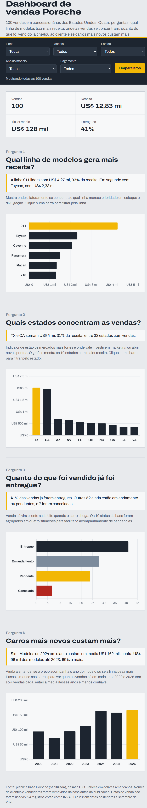
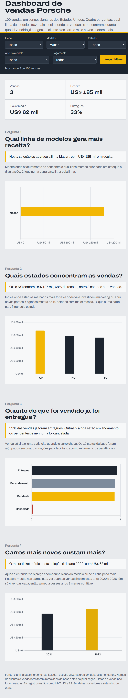

# Dashboard de vendas Porsche 🏎️

Dashboard interativa para analisar 100 vendas de veículos Porsche em concessionárias dos Estados Unidos. Projeto desenvolvido como desafio da DIO, com foco em transformar dados tratados em respostas visuais para perguntas de negócio.

🔗 **Dashboard publicada:** [car-cmd.github.io/dashboard-vendas-porsche](https://car-cmd.github.io/dashboard-vendas-porsche/)

## Perguntas de negócio e por quê

1. **Qual linha de modelos gera mais receita?** Mostra onde o faturamento se concentra e qual linha priorizar em estoque e divulgação. A linha 911 lidera com **US$ 4,27 milhões**, cerca de **33% da receita**.
2. **Quais estados concentram as vendas?** Ajuda a identificar os mercados mais fortes para orientar investimentos em marketing. **Texas (TX) e Califórnia (CA) somam 31% da receita**.
3. **Quanto do que foi vendido já foi entregue?** Acompanha as pendências da operação. **41% das vendas foram entregues** e **7 foram canceladas**.
4. **Carros mais novos custam mais?** Compara o preço médio por ano do modelo. Modelos de **2024 em diante custam em média 69% a mais** que os modelos até 2023.

## Tratamento da base 🧹

- O CSV final contém 10 colunas sanitizadas, com cabeçalhos em português: `id_venda`, `modelo`, `ano_modelo`, `preco_usd`, `quilometragem`, `forma_pagamento`, `cidade`, `estado`, `situacao_entrega` e `familia`.
- Os nomes de clientes e vendedores foram removidos por serem dados pessoais. A planilha original permanece fora do repositório; o `.gitignore` impede seu envio acidental.
- Preço, ano do modelo e quilometragem estão como números, sem fórmulas.
- A coluna `familia` agrupa os 40 modelos nas seis linhas: 718, 911, Cayenne, Macan, Panamera e Taycan.
- A data da venda não foi usada: 24 registros estavam como `INVALID` e 23 tinham datas posteriores a setembro de 2026.
- Os 10 status de entrega foram agrupados em quatro situações: entregue, em andamento, pendente e cancelada.

O arquivo `dados-porsche-tratados.csv` contém os 100 registros usados na análise. A dashboard inclui os dados necessários para funcionar sem carregar o CSV em tempo de execução.

## Ferramentas usadas 🛠️

Claude, IA da Anthropic, foi usado no chat para tratar a base, sugerir perguntas de negócio e gerar o HTML com Chart.js. Os resultados foram validados e os ajustes foram solicitados durante o desenvolvimento. VS Code e Claude Code foram usados para preparar este README e apoiar a publicação.

## Prompt e evolução

O pedido inicial foi transformar a planilha em uma dashboard HTML com filtros, indicadores e três perguntas de negócio. Depois, foi incluída uma quarta pergunta para analisar a relação entre o ano do modelo e o preço.

## Funcionalidades 📊

- Indicadores de vendas, receita, ticket médio e percentual de veículos entregues.
- Filtros por linha, modelo, estado, ano do modelo e forma de pagamento.
- Clique nas barras dos gráficos de linha e estado para filtrar os resultados.
- Respostas das quatro perguntas de negócio atualizadas conforme os filtros selecionados.
- Botão para limpar todos os filtros.

## Capturas de tela 🖼️

### Dashboard completa

### Filtro pelo modelo Macan

## Arquivos

- `index.html`: dashboard interativa, com dados incorporados e gráficos Chart.js.
- `dados-porsche-tratados.csv`: base sanitizada com 100 vendas.
- `images/dashboard-completa.png`: captura da dashboard sem filtros.
- `images/filtro-macan.png`: captura após filtrar pelo modelo Macan.

## GitHub Pages

O site é estático e não precisa de etapa de build. No repositório do GitHub, acesse **Settings → Pages**, escolha **Deploy from a branch**, selecione a branch `main` e a pasta `/root`, e salve. Aguarde a publicação e abra o endereço informado pelo GitHub Pages.

Para testar localmente, abra `index.html` em um navegador com conexão à internet, necessária para carregar Chart.js e a fonte externa. O CSV está disponível para consulta e não é necessário para renderizar a dashboard.